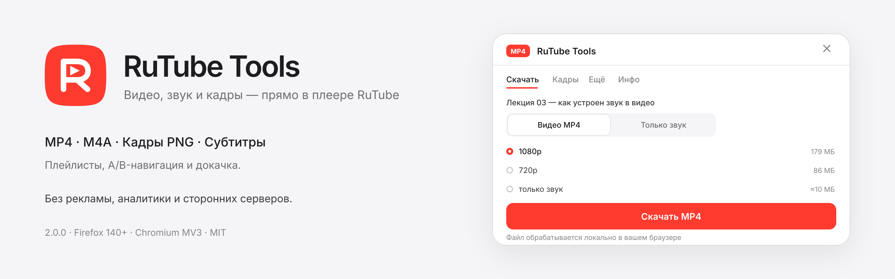
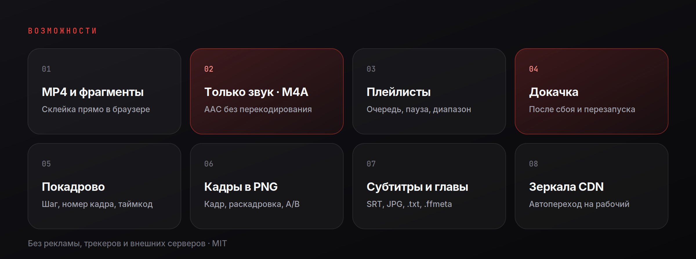
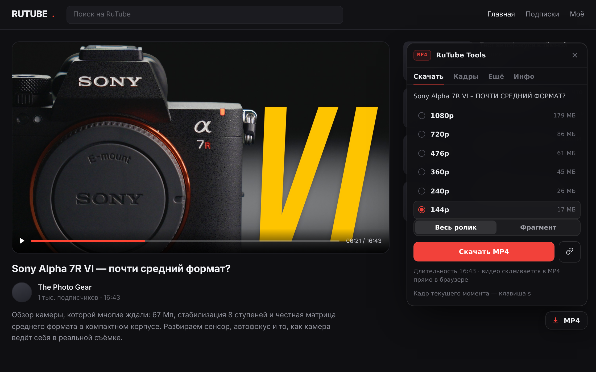
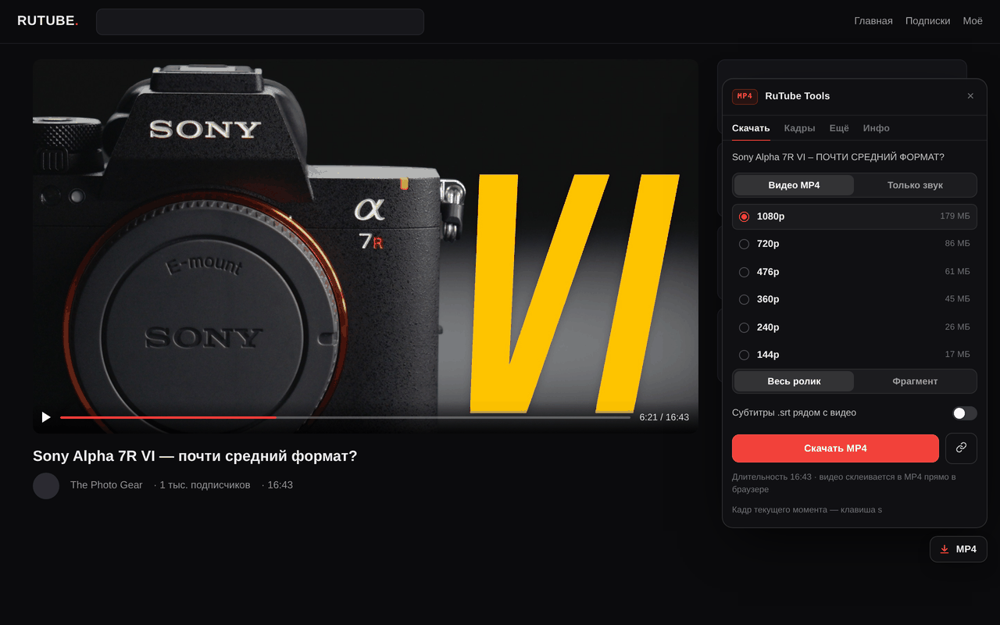
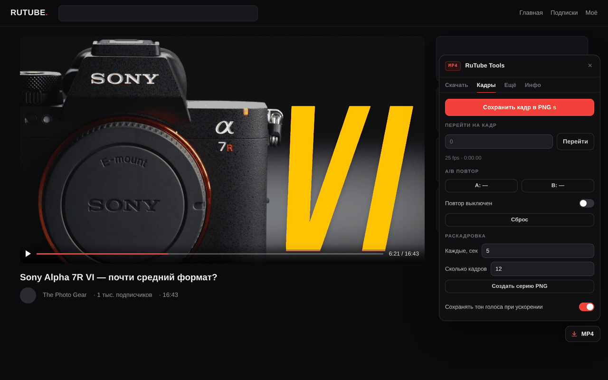
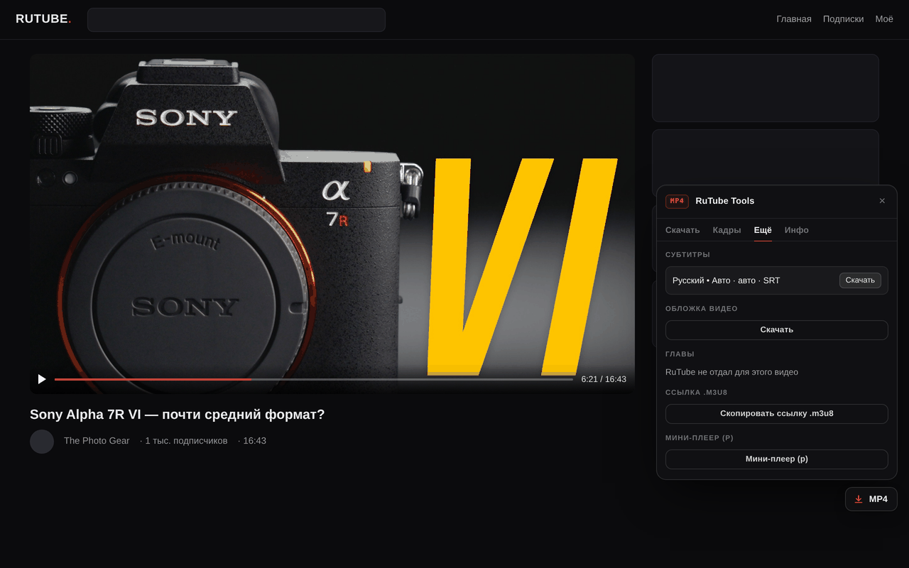
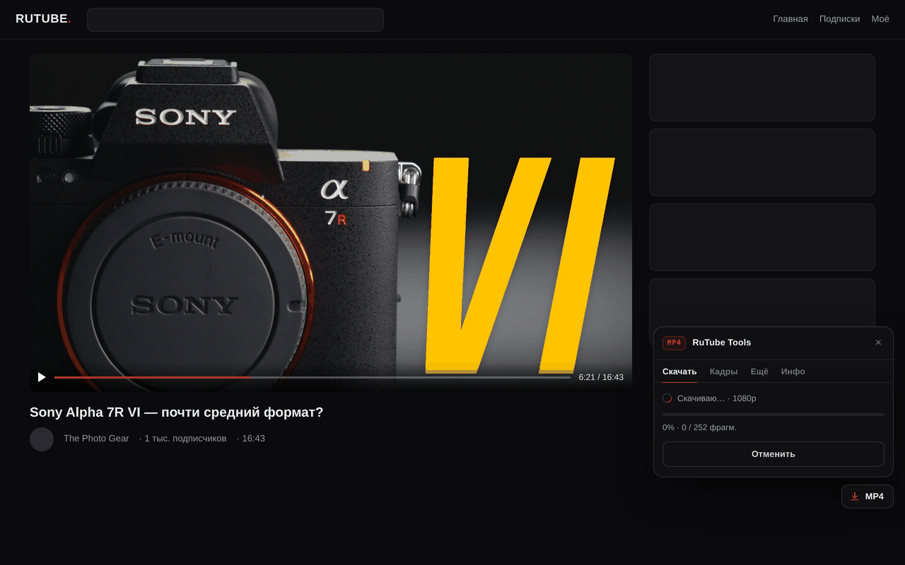
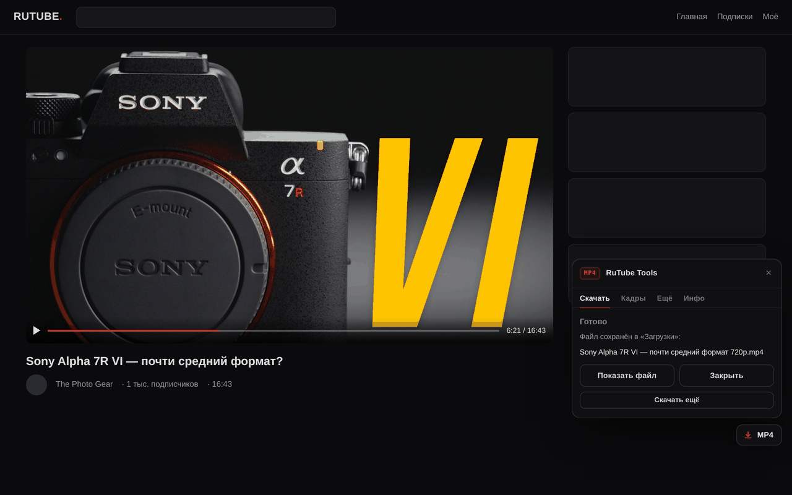
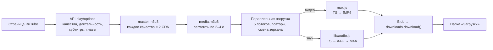

<div align="center">



<h1>RuTube Tools</h1>

<p><b>Расширение для RuTube: MP4 и только звук, плейлисты, покадровая перемотка, кадры в PNG и субтитры.</b><br>
Без рекламы, трекеров и сторонних программ — всё работает локально в браузере.</p>

<a href="https://github.com/xxnetme/rutube-tools/releases/latest"></a>
<a href="https://github.com/xxnetme/rutube-tools/actions/workflows/checks.yml"></a>


<a href="LICENSE"></a>

<p>
<a href="https://github.com/xxnetme/rutube-tools/releases/latest/download/rutube-tools-firefox.xpi"><b>Firefox (.xpi)</b></a> &nbsp;·&nbsp;
<a href="https://github.com/xxnetme/rutube-tools/releases/latest/download/rutube-tools-chromium.zip"><b>Chrome / Edge (.zip)</b></a> &nbsp;·&nbsp;
<a href="https://xxnetme.github.io/rutube-tools/">Сайт</a>
</p>

<p>
<a href="#установка">Установка</a> &nbsp;·&nbsp;
<a href="#возможности">Возможности</a> &nbsp;·&nbsp;
<a href="#клавиши">Клавиши</a> &nbsp;·&nbsp;
<a href="#как-это-работает">Как это работает</a> &nbsp;·&nbsp;
<a href="#ограничения">Ограничения</a> &nbsp;·&nbsp;
<a href="#вопросы-и-ответы">Вопросы</a>
</p>

</div>

---

> [!TIP]
> **Новое в 1.9.0:** субтитры SRT можно сохранить как **WebVTT** — время, многострочный текст
> и cue settings сохраняются, повреждённый файл не скачивается под видом готового.
> С 1.8.0 здесь же: кадры в JPEG и WebP, копирование кадра в буфер, контактный лист и серия между A и B. <!-- ver:prev -->
> С 1.7.0 здесь же: выбор серий галочками в плейлисте и история сохранённых файлов. <!-- ver:prev -->
> С 1.6.0 здесь же: теги в M4A (обложка, альбом, номер серии), с 1.5.0 — субтитры одной галочкой, <!-- ver:prev -->
> шаблон имени и формат по умолчанию. Полный список — в [CHANGELOG](docs/CHANGELOG.md).

## Что это

**RuTube Tools** — бесплатное расширение для Firefox, Chrome, Edge и Яндекс.Браузера. Добавляет в плеер RuTube
небольшую панель: скачать видео или только звук, вырезать фрагмент, забрать весь плейлист, листать видео по кадрам,
сохранять кадры в PNG, субтитры в SRT и VTT и обложки.



---

## Установка

| | Firefox | Chrome · Edge · Яндекс |
|---|---|---|
| **0. Магазин** | [Открыть в Firefox Add-ons](https://addons.mozilla.org/ru/firefox/addon/rutube-tools/) — кнопка «Добавить в Firefox» | пока нет в магазине, шаги ниже |
| **1. Скачать** | [rutube-tools-firefox.xpi](https://github.com/xxnetme/rutube-tools/releases/latest/download/rutube-tools-firefox.xpi) — свежая сборка | [rutube-tools-chromium.zip](https://github.com/xxnetme/rutube-tools/releases/latest/download/rutube-tools-chromium.zip), распаковать |
| **2. Открыть** | `about:debugging#/runtime/this-firefox` | `chrome://extensions` |
| **3. Подключить** | «Загрузить временное дополнение…» | «Режим разработчика» → «Загрузить распакованное» |

Откройте любое видео RuTube — кнопка **MP4** появится в правом нижнем углу плеера. На странице плейлиста (`/plst/…`) она станет **PL**.

> [!NOTE]
> **В Firefox — ставится одной кнопкой:** [RuTube Tools в Firefox Add-ons](https://addons.mozilla.org/ru/firefox/addon/rutube-tools/).
> Дополнение проверено Mozilla и обновляется само; временная установка через `about:debugging` нужна только
> для свежей сборки из `main`, которой ещё нет в магазине.
> Chrome Web Store, Edge Add-ons и Opera — сборка готова, подача впереди:
> файлы, тексты карточек и заметки ревьюерам лежат в [docs/PUBLISH.md](docs/PUBLISH.md) и [docs/store/listing-ru.md](docs/store/listing-ru.md).

<details>
<summary>Сборка из исходников</summary>

```bash
git clone https://github.com/xxnetme/rutube-tools.git
cd rutube-tools
python3 build.py
```

Нужен только Python 3: сборка проверяет обязательные файлы, манифест и отсутствие `eval`,
затем складывает распакованные версии в `build/`, а воспроизводимые архивы, `.xpi` и `SHA256SUMS` — в `release/`.

</details>

---

## Интерфейс



<table>
<tr>
<td width="50%"><br>
<sub><b>Скачать</b> — формат (видео или звук), качества, оценка размера, весь ролик или фрагмент</sub></td>
<td width="50%"><br>
<sub><b>Кадры</b> — шаг по кадрам, переход по номеру, петля A/B, раскадровка</sub></td>
</tr>
<tr>
<td><br>
<sub><b>Ещё</b> — субтитры, обложка, главы (в файл), ссылка .m3u8, мини-плеер</sub></td>
<td><br>
<sub><b>Инфо</b> — кодек, fps, битрейт, качества, просмотры, дата</sub></td>
</tr>
<tr>
<td><br>
<sub><b>Прогресс</b> — фрагменты, мегабайты, скорость, текущий сервер</sub></td>
<td><br>
<sub><b>Готово</b> — файл в загрузках, «показать файл», «скачать ещё»</sub></td>
</tr>
</table>

<sub>Скриншоты сделаны на сборке 1.7.0 <!-- ver:prev -->: переключатель «Видео / Только звук», докачка и размеры из настоящего API RuTube.</sub>

---

## Возможности

### Скачивание

| | |
|---|---|
| **MP4 целиком** | 1080p…144p. Фрагменты потока качаются параллельно и собираются в обычный MP4 в браузере |
| **Только звук (M4A)** | Переключатель «Видео / Только звук». Качается самый лёгкий поток, AAC достаётся без перекодирования. В файл пишутся обложка, автор, альбом и номер серии — подкаст из плейлиста сортируется в плеере сам. Работает для фрагмента и плейлиста |
| **Фрагмент** | «с 12:30 по 12:45». Кнопка со временем берёт позицию прямо из плеера; фактические границы видны до старта |
| **Плейлист** | На странице `/plst/…`: список серий с галочками, названиями и длительностью, счётчик «Выбрано 10 из 12», «Все» и «Ни одной». Очередь с паузой и отчётом по каждому видео |
| **Докачка** | Закрыли браузер или была ошибка — в окне расширения будет «Незавершённые загрузки» с кнопкой «Продолжить». Уже сохранённые части и серии заново не качаются |
| **История файлов** | В окне расширения — «Сохранённые файлы»: последние 30 загрузок с именем, временем и кнопкой «Показать файл» |
| **Резервная копия настроек** | Экспорт и импорт JSON в окне расширения. Схема версионируется, значения проверяются, чужие ключи и история загрузок не переносятся; при ошибке записи прежние настройки восстанавливаются |
| **Зеркала CDN** | Каждое качество RuTube отдаёт с двух серверов — при обрыве расширение перечитывает плейлист с резервного |
| **Длинные файлы** | Автоматическое разбиение по ~220 МБ: `название — 1/3.mp4` |
| **После сбоя** | «Повторить загрузку» и «Скопировать диагностику» — готовый текст для письма в поддержку |

### Кадры

Шаг вперёд и назад по кадрам с показом номера и таймкода, сохранение кадра в PNG,
переход на кадр по номеру, петля A/B и раскадровка серией PNG через заданный интервал (до 120 кадров).
Тон голоса при ускорении сохраняется. Имя файла задаётся шаблоном (`{title}`, `{author}`, `{quality}`,
`{date}`, `{playlist}`), а `/` в шаблоне раскладывает серии подкаста по папкам.

### Ещё и Инфо

Субтитры SRT, включая авто-субтитры: галочка в «Скачать» кладёт `.srt` рядом с видео с тем же именем,
поэтому VLC и mpv подхватывают их сами. Во вкладке «Ещё» тот же SRT можно преобразовать и сохранить
как `.vtt`. Обложка в JPG, главы из `cuepoints` (копирование, файл `.txt` и `.ffmeta`
для вшивания в MP4), мини-плеер (Picture-in-Picture) и ссылка `.m3u8`. Вкладка «Инфо» показывает кодек, fps, битрейт,
доступные качества, оценку размера, просмотры, дату публикации и автора — с копированием одним нажатием.

<details>
<summary>Как вшить главы в MP4</summary>

Сохраните главы кнопкой «Главы → .ffmeta» во вкладке «Ещё», затем:

```bash
ffmpeg -i видео.mp4 -i главы.ffmeta -map_metadata 1 -map_chapters 1 -c copy готово.mp4
```

Перекодирования нет: видео и звук копируются как есть.

</details>

---

## Клавиши

| Клавиша | Действие |
|---|---|
| <kbd>,</kbd> <kbd>.</kbd> | кадр назад / кадр вперёд |
| <kbd>&lt;</kbd> <kbd>&gt;</kbd> | скорость − / + (0.25× … 2×) |
| <kbd>s</kbd> | сохранить кадр в PNG |
| <kbd>p</kbd> | мини-плеер |
| <kbd>?</kbd> | подсказка на странице |

Полный набор «как на YouTube» включается в настройках: <kbd>Space</kbd>/<kbd>K</kbd> — пауза,
<kbd>J</kbd>/<kbd>L</kbd> — ±10 с, стрелки — перемотка и громкость, <kbd>M</kbd> — звук,
<kbd>0</kbd>–<kbd>9</kbd> — переход по проценту. Клавиши кадров и кадра PNG переназначаются.

---

## Как это работает



Файл скачивается без перекодирования. Сегменты попадают в сборщик строго по порядку даже при параллельной
загрузке. Перед сохранением MP4/M4A дополнительно проверяются дорожки, media data и длительность;
результат также проверен `ffprobe` (включая теги и обложку) и декодированием в `ffmpeg`.
Сборка идёт в фоновой странице Firefox или в offscreen-документе Chromium. Состояние загрузки сохраняется
в `storage.local`, поэтому её можно продолжить после сбоя.

---

## Ограничения

| Что | Поведение |
|---|---|
| Прямые эфиры | не скачиваются, кнопка сообщает об этом |
| DRM-видео | не скачиваются |
| HEVC и AV1 | сохраняются как `.ts`, открывается в VLC |
| Гео-блокировка RuTube | не обходится |
| Только звук (M4A) | только AAC (так отдаёт RuTube); другой кодек — понятная ошибка. Трафик равен весу самого лёгкого видеопотока |
| Докачка | с границы части или серии, не с середины файла; записи хранятся 14 дней |
| Скорость | ограничена отдачей CDN RuTube |
| Кадр в PNG | если браузер запрещает чтение видеопотока, кадр сохранить нельзя — расширение скажет об этом |

---

## Приватность

Ноль аналитики, телеметрии и рекламы. Расширение работает только на `rutube.ru`, запросы идут
исключительно к RuTube и его CDN, без cookie. Настройки, позиция просмотра и записи о незавершённых
загрузках хранятся локально в `storage.local`. В манифесте указано `data_collection_permissions: none`.
Подробнее — [страница политики](https://xxnetme.github.io/rutube-tools/privacy.html) или [docs/PRIVACY.md](docs/PRIVACY.md) в репозитории.

---

## Качество

Проект покрыт автотестами (`npm test` — 115 JS-проверок, плюс 15 Python unit-тестов инфраструктуры).
В CI они идут вместе с ESLint, `no-unsanitized`, JSDoc/`tsc --checkJs`, `addons-linter` и
браузерным E2E в Firefox и Chromium:

- разбор HLS, диапазоны, разбиение на части, главы (результат принимает `ffmpeg`);
- извлечение звука: байт-в-байт сверка кадров, склейка кадров на границах PES и сегментов, настоящий поток от `ffmpeg` и проверка `ffprobe`;
- сквозные сценарии фона с подменёнными браузером и RuTube: докачка, «перезапуск браузера», зеркала CDN, пауза и отмена;
- повреждённый MP4 и расхождение длительности отклоняются до вызова `downloads.download`;
- смоук-тест панели в jsdom и проверка, что строки API не становятся HTML;
- сетевой allowlist и редиректы, включая запрет скрытого `opaqueredirect`;
- настоящие расширения в Firefox и Chromium: локальный HLS, скачанный MP4, H.264 + AAC и `ffprobe`;
- настоящий Chromium popup: импорт настроек, отказ невалидного JSON и откат ошибки записи;
- CONNECT-прокси в E2E записывает все попытки соединений и падает на любом хосте вне стенда;
- валидатор публичного API и JWT-издатель AMO — отдельно, без сети и настоящих секретов.

Тесты ищут реальные ошибки: код намеренно ломали (потеря хвоста кадра, неверное смещение, докачка с нуля), и тесты падали.

Отдельный workflow **RuTube API** раз в сутки делает один read-only запрос к публичному
`play/options`: при изменении контракта ведёт одно issue, после восстановления закрывает его,
а сетевую ошибку не выдаёт за изменение API. Для следующих тегов Release прикладывает
`SHA256SUMS` и создаёт GitHub build-provenance attestations для трёх пакетов.

<details>
<summary>Запуск проверок</summary>

```bash
npm ci                         # нужен Node 22+
npm test
npm run lint                   # ESLint + no-unsanitized
npm run typecheck              # JSDoc + tsc --checkJs
python3 -m unittest discover -s tests -p 'test_*.py' -v
python3 build.py
(cd release && sha256sum -c SHA256SUMS)
```

Браузерный E2E (нужны Python 3.12+, `ffmpeg`, `ffprobe` и `openssl`):

```bash
npx playwright install --with-deps chromium firefox
python3 -m pip install -r tests/e2e/requirements.txt
npm run test:e2e
```

Подробности стенда и его артефактов — в [tests/e2e/README.md](tests/e2e/README.md).
Изолированный замер памяти без изменения расширения: `npm run bench:opfs`
([методика и результаты](docs/OPFS-PROTOTYPE.md)).
Тесты звука используют `ffmpeg`/`ffprobe`, если они установлены, и пропускают эти проверки, если нет;
для E2E эти программы обязательны.

</details>

---

## Структура

```text
rutube-tools/
├── src/
│   ├── manifest.firefox.json    MV3, background.scripts
│   ├── manifest.chromium.json   MV3, service_worker + offscreen
│   ├── background.js            загрузки, очередь, докачка, обрезка, зеркала, диагностика
│   ├── content-core.js          кнопка, панель, вкладки, клавиши, кадры, PiP
│   ├── content-panel.js         Скачать / Кадры / Ещё / Инфо
│   ├── lib/engine.js            HLS, диапазоны, плейлисты, склейка, главы
│   ├── lib/audio.js             TS → AAC → M4A (режим «только звук»)
│   ├── lib/i18n.js              русский и английский
│   ├── lib/settings.js          настройки и версионированный JSON backup
│   ├── lib/mux-mp4.min.js       mux.js, Apache 2.0
│   ├── popup.html, popup.js     настройки, активные и незавершённые загрузки
│   └── offscreen.html, .js      сборка файла для Chromium
├── tests/                       JS: движок, звук, фон, панель; Python: монитор, AMO JWT и browser E2E
├── build.py                     сборка, проверки и SHA256SUMS, только stdlib
├── eslint.config.js, package.json   только для тестов и линтера
├── docs/                        сайт (галерея тянется мышью, демо кадров), privacy.html, CHANGELOG, ROADMAP
├── assets/                      баннеры и обложка, исходники в SVG
└── .github/workflows/           checks, release по тегу и ежедневный монитор RuTube API
```

---

## Проверено на живом RuTube

- Полное видео 16:43 → MP4 20,9 МБ, `ffmpeg` декодирует без ошибок
- Фрагмент 1:40–2:10 → файл длиной 32,15 с, старт со 100-й секунды
- Плейлист из двух видео → два валидных файла, 45,4 и 42,2 МБ
- Субтитры SRT (41 КБ) и обложка JPG (268 КБ) сохранены из Firefox
- PNG-кадры и раскадровка, петля A/B не выходит за границы
- Переключение RU/EN на лету, консоль без ошибок

<sub>Звук M4A, докачка (1.4.0) и субтитры с шаблоном имени (1.5.0) проверены автотестами на потоках `ffmpeg` и подменённом RuTube; прогон на живом сайте — перед публикацией релиза.</sub> <!-- ver:prev -->

---

## Вопросы и ответы

<details>
<summary><b>Как скачать видео с RuTube в MP4?</b></summary>

Откройте страницу видео, нажмите кнопку **MP4** в правом нижнем углу, выберите качество и нажмите
«Скачать MP4». Файл соберётся в браузере и появится в папке «Загрузки».

</details>

<details>
<summary><b>Как скачать только звук?</b></summary>

Во вкладке «Скачать» переключите формат на «Только звук». Расширение возьмёт самый лёгкий поток (обычно 144p),
вытащит из него AAC и сохранит `.m4a` без перекодирования. Так же работает фрагмент и плейлист — удобно для подкастов и лекций.

</details>

<details>
<summary><b>Загрузка оборвалась — что делать?</b></summary>

Откройте окно расширения (иконка в панели браузера): в блоке «Незавершённые загрузки» нажмите «Продолжить».
Уже сохранённые части видео или серии плейлиста заново не качаются. Записи хранятся 14 дней.

</details>

<details>
<summary><b>Можно ли скачать только фрагмент видео?</b></summary>

Да. Во вкладке «Скачать» переключитесь на «Фрагмент» и укажите начало и конец, например `12:30` и `12:45`.
Границы привязываются к фрагментам потока (2–4 секунды), поэтому файл может начинаться на пару секунд раньше.

</details>

<details>
<summary><b>Как скачать весь плейлист RuTube?</b></summary>

Откройте страницу плейлиста (`/plst/…`) — кнопка станет **PL**. Отметьте галочками нужные серии: в списке
видны названия и длительность, рядом счётчик «Выбрано 10 из 12», кнопки «Все» и «Ни одной» экономят время
на длинных сезонах. Затем «Скачать плейлист» — видео загружаются по очереди с паузой; очередь можно
поставить на паузу или отменить.

</details>

<details>
<summary><b>Как сохранить кадр в PNG?</b></summary>

Нажмите <kbd>s</kbd> — кадр текущего момента сохранится картинкой с таймкодом в имени файла.
Для серии кадров откройте вкладку «Кадры» и задайте интервал раскадровки (до 120 кадров).

</details>

<details>
<summary><b>Как скачать субтитры и главы?</b></summary>

Вкладка «Ещё» → «Субтитры» → «Скачать». Сохраняется файл `.srt`, включая авто-субтитры RuTube.
Кнопка `VTT` рядом конвертирует SRT в WebVTT и сохраняет отдельный `.vtt`.
Там же обложка в JPG, ссылка `.m3u8` и главы: копирование текстом, файл `.txt` или `.ffmeta` для вшивания в MP4.

</details>

<details>
<summary><b>Почему видео сохранилось как .ts, а не .mp4?</b></summary>

Так бывает с кодеками HEVC и AV1: собрать из них MP4 в браузере нельзя без перекодирования.
Файл сохраняется как `.ts` и открывается в VLC. Видео в H.264 всегда собираются в обычный MP4.
Режим «Только звук» от кодека видео не зависит.

</details>

<details>
<summary><b>Почему не скачивается прямой эфир или платное видео?</b></summary>

Прямые трансляции и видео с DRM-защитой не поддерживаются — это осознанное ограничение.
Расширение не обходит защиту и работает только с открытыми видео.

</details>

<details>
<summary><b>Расширение что-то отправляет на серверы?</b></summary>

Нет. Ни аналитики, ни рекламы, ни собственных серверов: запросы идут только к RuTube и его CDN,
без cookie. Настройки, позиция просмотра и список незавершённых загрузок хранятся локально в браузере.

</details>

<details>
<summary><b>Работает ли в Chrome, Edge и Яндекс.Браузере?</b></summary>

Да. Для Chromium-браузеров есть отдельная сборка (`.zip`), устанавливается через
«Режим разработчика» → «Загрузить распакованное».

</details>

---

## Автор

<table>
<tr>
<td width="72"></td>
<td>

**xxnetme** — разработчик и автор проекта<br>
<sub><a href="https://github.com/xxnetme">github.com/xxnetme</a> · <a href="https://github.com/xxnetme/rutube-tools/issues">сообщить о проблеме</a> · <a href="https://github.com/xxnetme/rutube-tools/blob/main/SECURITY.md">безопасность</a></sub>

</td>
</tr>
</table>

Проект распространяется по лицензии [MIT](LICENSE). Сторонние компоненты перечислены в
[THIRD-PARTY-NOTICES.md](THIRD-PARTY-NOTICES.md).

<sub>Расширение не обходит DRM и не скачивает закрытые видео. Скачивайте только то, на что у вас есть право.</sub>
