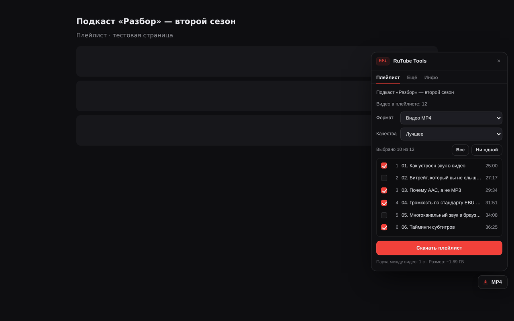
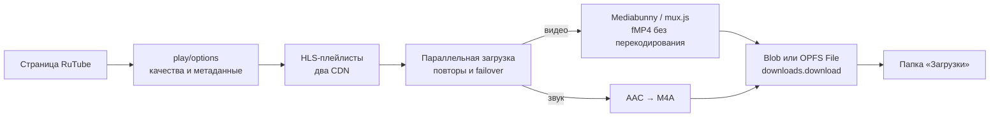

<div align="center">


<p>
<a href="https://github.com/xxnetme/rutube-tools/releases/latest/download/rutube-tools-firefox.xpi"><b>Скачать для Firefox</b></a>
&nbsp;·&nbsp;
<a href="https://github.com/xxnetme/rutube-tools/releases/latest/download/rutube-tools-chromium.zip"><b>Скачать для Chromium</b></a>
&nbsp;·&nbsp;
<a href="https://xxnetme.github.io/rutube-tools/"><b>Открыть сайт</b></a>
</p>

<p>
<a href="#быстрый-старт">Установка</a> ·
<a href="#возможности">Возможности</a> ·
<a href="#интерфейс">Интерфейс</a> ·
<a href="#приватность">Приватность</a> ·
<a href="#разработка">Разработка</a> ·
<a href="#вопросы-и-ответы">FAQ</a>
</p>

</div>

---

## Быстрый старт

| Firefox | Chrome · Edge · Яндекс.Браузер |
|---|---|
| **Стабильная версия:** [Firefox Add-ons](https://addons.mozilla.org/ru/firefox/addon/rutube-tools/) → «Добавить в Firefox». | **1.** Скачайте [Chromium ZIP](https://github.com/xxnetme/rutube-tools/releases/latest/download/rutube-tools-chromium.zip) и распакуйте. |
| **Актуальная сборка 2.0.0:** скачайте [XPI](https://github.com/xxnetme/rutube-tools/releases/latest/download/rutube-tools-firefox.xpi). | **2.** Откройте `chrome://extensions` и включите «Режим разработчика». |
| Откройте `about:debugging#/runtime/this-firefox` → «Загрузить временное дополнение…» → выберите XPI. | **3.** «Загрузить распакованное» → выберите папку с `manifest.json`. |

После установки откройте видео на RuTube. Кнопка **MP4** появится в правом нижнем углу плеера;
на странице плейлиста `/plst/…` — кнопка **PL**.

> [!NOTE]
> В AMO опубликована та же сборка 2.0.0, что и в GitHub Release. Магазин подписывает XPI сам,
> поэтому байты и контрольная сумма скачанного оттуда файла отличаются от релизного.
> Временная установка через `about:debugging` остаётся запасным путём.
> Chrome Web Store, Edge Add-ons и Opera Add-ons пока не считаются опубликованными каналами.

---

## Возможности

| Скачивание | Плеер и кадры |
|---|---|
| **MP4 / fMP4.** Весь ролик или фрагмент, качества от 1080p до 144p, сборка прямо в браузере. | **Точная навигация.** Шаг по кадрам, переход по номеру для CFR, A/B-маркеры с preview. |
| **HEVC и AV1.** Перенос без перекодирования с `hvcC` / `av1C`; при неподдерживаемом контейнере — честный `.ts` fallback. | **rVFC и VFR.** Ожидание показанного кадра; для VFR отображается временной шаг, а не выдуманный абсолютный номер. |
| **Только звук M4A.** AAC без перекодирования, обложка и теги, удобная сортировка подкастов. | **PNG · JPEG · WebP.** Одиночные кадры, серия до 120 кадров, контактный лист и копирование в буфер. |
| **Плейлисты.** Выбор серий галочками, очередь, пауза, отчёт по каждому видео. | **Скорость по `videoId`.** Отдельная скорость для каждого видео, сохранение тона и позиции просмотра. |
| **Докачка.** Готовые части и серии не загружаются повторно; с OPFS opt-in — продолжение со следующего сегмента. | **Доступность.** Focus trap и возврат фокуса, клавиатурные вкладки, `aria-live`, reduced motion. |

### Метаданные и локализация

- **Субтитры:** SRT, включая автоматические; локальный экспорт в WebVTT.
- **Обложка и главы:** JPG, копирование таймкодов, `.txt` и `.ffmeta`.
- **Имя файла:** `{title}`, `{author}`, `{quality}`, `{date}`, `{playlist}`; `/` создаёт подпапки.
- **Интерфейс:** русский, английский, украинский и белорусский — RU / EN / UK / BE.
- **Настройки:** версионированный JSON backup/restore с проверкой значений и откатом при ошибке.

### Надёжность

| Механизм | Что делает |
|---|---|
| **Зеркала CDN** | Повторяет запросы и переключается на резервный сервер RuTube при обрыве |
| **Длинные видео** | Автоматически делит результат на части примерно по 220 МБ |
| **OPFS opt-in** | Worker, индекс сегментов, очистка и memory fallback при квоте; по умолчанию выключен |
| **История** | Последние 30 сохранённых файлов и незавершённые загрузки в окне расширения |
| **Диагностика** | Локальный отчёт об ошибке для issue — без телеметрии и скрытой отправки |

Почему OPFS не включён для всех и что показал замер на 2048 МиБ —
в [отчёте по хранилищу](docs/OPFS-PROTOTYPE.md). Полный список изменений —
в [CHANGELOG](docs/CHANGELOG.md).

---

## Интерфейс

<table>
<tr>
<td width="50%">
<br>
<sub><b>Скачать.</b> Видео или звук, качество, размер и границы фрагмента.</sub>
</td>
<td width="50%">
<br>
<sub><b>Кадры.</b> Навигация, A/B, серия и сохранение изображений.</sub>
</td>
</tr>
<tr>
<td>
<br>
<sub><b>Ещё.</b> Субтитры, WebVTT, обложка, главы и мини-плеер.</sub>
</td>
<td>
<br>
<sub><b>Плейлист.</b> Только нужные серии, с понятной очередью.</sub>
</td>
</tr>
</table>

<sub>Скриншоты интерфейса сняты на сборке 1.7.0 <!-- ver:prev --> и не выдаются за снимки 2.0.0;
размеры и качества получены из настоящего API RuTube. Новые возможности 2.0.0 описаны выше.</sub><br>
[Полная галерея и интерактивное демо](https://xxnetme.github.io/rutube-tools/).

---

## Горячие клавиши

| Клавиша | Действие |
|---|---|
| <kbd>,</kbd> / <kbd>.</kbd> | кадр назад / вперёд |
| <kbd>&lt;</kbd> / <kbd>&gt;</kbd> | скорость − / +, от 0.25× до 2× |
| <kbd>s</kbd> | сохранить текущий кадр |
| <kbd>p</kbd> | Picture-in-Picture |
| <kbd>?</kbd> | показать подсказку |

Дополнительно включается набор «как на YouTube»: <kbd>Space</kbd>/<kbd>K</kbd>,
<kbd>J</kbd>/<kbd>L</kbd>, стрелки, <kbd>M</kbd> и <kbd>0</kbd>–<kbd>9</kbd>.
Клавиши покадрового шага и сохранения кадра можно изменить в настройках.

---

## Как это работает



- Сегменты попадают в сборщик строго по порядку даже при параллельной загрузке.
- Перед сохранением проверяются дорожки, media data и длительность; повреждённый файл не выдаётся за готовый.
- В Firefox работает background page, в Chromium — offscreen document.
- Состояние хранится локально; OPFS используется только после явного включения и имеет memory fallback.

Никаких внешних вычислительных сервисов: медиаданные обрабатываются на устройстве пользователя.

---

## Приватность

**Ноль аналитики, рекламы и трекеров.** Нет собственных серверов и удалённого кода.

- Сетевой allowlist ограничен RuTube и его CDN; запросы выполняются без cookie.
- Настройки, позиция и история остаются в `storage.local` на устройстве.
- При включённом OPFS временные файлы и индекс находятся в локальном Origin Private File System.
- В манифесте указано `data_collection_permissions: none`.

Полный текст: [privacy policy](https://xxnetme.github.io/rutube-tools/privacy.html) ·
[docs/PRIVACY.md](docs/PRIVACY.md).

---

## Ограничения

| Сценарий | Поведение |
|---|---|
| Прямые эфиры и DRM | Не поддерживаются; защита и ограничения доступа не обходятся |
| Геоблокировка | Не обходится |
| HEVC / AV1 | Сначала fMP4; если конкретный контейнер не читается, сохраняется исходный `.ts` для VLC |
| OPFS | Не отменяет квоту и лимиты браузера; при ошибке используется memory fallback |
| Докачка | Записи хранятся 14 дней; segment resume доступен при OPFS opt-in |
| Скорость загрузки | Зависит от отдачи RuTube и сети пользователя |

Скачивайте только те материалы, на которые у вас есть право.

---

## Качество

| Контур | Подтверждение |
|---|---|
| **Автотесты** | 133 JS + 15 Python — 148 проверок, включая медиа, миграции, protocol v2 и сетевой allowlist |
| **Browser E2E** | Firefox и Chromium: реальные расширения, MP4/`ffprobe`, player, UK/BE, OPFS, HEVC/AV1 и downloads |
| **Статический анализ** | ESLint, `no-unsanitized`, JSDoc/`tsc --checkJs` |
| **Пакеты** | Воспроизводимые ZIP/XPI, `SHA256SUMS`, GitHub build-provenance attestations |
| **Манифест** | `addons-linter`: 0 ошибок для 2.0.0; одно задокументированное предупреждение только про Android |

CI запускает обязательные проверки для Firefox и Chromium. Отдельный ежедневный workflow
делает один read-only запрос к публичному API RuTube и отслеживает изменение контракта.

---

## Разработка

Требования: **Node.js 22+**, **Python 3**; для полного набора медиатестов также `ffmpeg` и `ffprobe`.

```bash
git clone https://github.com/xxnetme/rutube-tools.git
cd rutube-tools
npm ci
python3 build.py
```

Результат:

```text
build/     распакованные Firefox и Chromium-версии
release/   ZIP, XPI и SHA256SUMS
```

<details>
<summary><b>Все команды проверки</b></summary>

```bash
npm test
npm run lint
npm run typecheck
python3 -m unittest discover -s tests -p 'test_*.py' -v
python3 build.py
(cd release && sha256sum -c SHA256SUMS)
python3 tools/check-versions.py
```

Browser E2E:

```bash
npx playwright install chromium firefox
python3 -m pip install -r tests/e2e/requirements.txt
npm run test:e2e
npm run test:e2e:opfs
```

Изолированный benchmark: `npm run bench:opfs`.
См. [tests/e2e/README.md](tests/e2e/README.md) и [docs/OPFS-PROTOTYPE.md](docs/OPFS-PROTOTYPE.md).

</details>

<details>
<summary><b>Структура проекта</b></summary>

```text
rutube-tools/
├── src/
│   ├── manifest.firefox.json     Firefox MV3
│   ├── manifest.chromium.json    Chromium MV3 + offscreen
│   ├── background.js             очередь, загрузки, докачка, диагностика
│   ├── content-core.js           плеер, клавиши, A/B, rVFC/VFR, доступность
│   ├── content-panel.js          Скачать / Кадры / Ещё / Инфо
│   ├── lib/
│   │   ├── engine.js             HLS, части, плейлисты, fallback
│   │   ├── audio.js              TS → AAC → M4A
│   │   ├── protocol.js           замороженный rt:* protocol v2
│   │   ├── settings.js           settings schema v2 и JSON backup
│   │   ├── opfs-worker.js        OPFS input/output/index
│   │   └── i18n*.js              RU / EN / UK / BE
│   └── popup.js                  настройки, история и незавершённые загрузки
├── modules/media.mjs              typed Mediabunny adapter
├── tests/                        unit, regression и browser E2E
├── docs/                         сайт, privacy, протокол, ROADMAP и публикация
├── assets/                       локальные изображения и SVG
└── .github/workflows/            Checks, Release, монитор RuTube API
```

</details>

### Документация

| Тема | Материал |
|---|---|
| Изменения и планы | [CHANGELOG](docs/CHANGELOG.md) · [ROADMAP](docs/ROADMAP.md) |
| Протокол и хранение | [PROTOCOL](docs/PROTOCOL.md) · [OPFS](docs/OPFS-PROTOTYPE.md) |
| Публикация | [PUBLISH](docs/PUBLISH.md) · [store-тексты](docs/store/listing-ru.md) |
| Участие и безопасность | [CONTRIBUTING](CONTRIBUTING.md) · [SECURITY](SECURITY.md) |

---

## Вопросы и ответы

<details>
<summary><b>Как скачать видео или только его фрагмент?</b></summary>

Нажмите **MP4** в плеере, выберите качество и режим «Весь ролик» или «Фрагмент».
Для фрагмента укажите начало и конец, например `12:30` и `12:45`. Фактические границы
привязаны к сегментам HLS и показываются до запуска.

</details>

<details>
<summary><b>Как сохранить подкаст или лекцию в M4A?</b></summary>

Во вкладке «Скачать» выберите «Только звук». Расширение извлечёт AAC без перекодирования
и сохранит `.m4a` с названием и тегами. Фрагменты и выбранные серии плейлиста поддерживаются.

</details>

<details>
<summary><b>Как продолжить загрузку после ошибки?</b></summary>

Откройте окно расширения → «Незавершённые загрузки» → «Продолжить». Уже сохранённые части
и серии повторно не загружаются. При включённом OPFS доступно продолжение со следующего сегмента.

</details>

<details>
<summary><b>Почему вместо MP4 получился .ts?</b></summary>

Это fallback, а не скрытое перекодирование. Сначала расширение пытается перенести HEVC/AV1
в fMP4. Если конкретный контейнер прочитать нельзя — например, AV1 в MPEG-TS — сохраняется
исходный `.ts`, который открывается в VLC. Audio-only MP4 не выдаётся за видео.

</details>

<details>
<summary><b>Отправляет ли расширение данные разработчику?</b></summary>

Нет. Аналитики и собственных серверов нет. Запросы идут только к RuTube и его CDN без cookie;
настройки и история остаются локально. См. [политику конфиденциальности](https://xxnetme.github.io/rutube-tools/privacy.html).

</details>

---

<div align="center">


**Разработчик — [xxnetme](https://github.com/xxnetme)**<br>
[MIT License](LICENSE) · [Third-party notices](THIRD-PARTY-NOTICES.md) ·
[Сообщить о проблеме](https://github.com/xxnetme/rutube-tools/issues)

<sub>RuTube Tools не обходит DRM и ограничения доступа.<br>
Используйте расширение только для контента, который у вас есть право сохранять.</sub>

</div>
