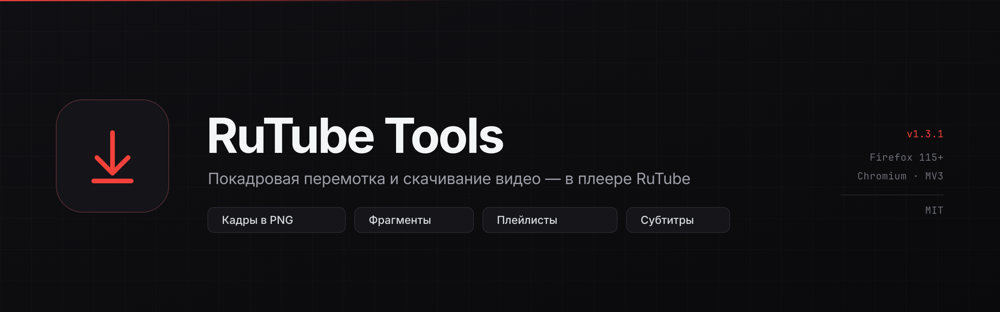
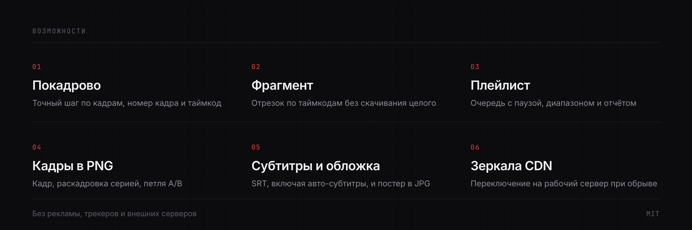
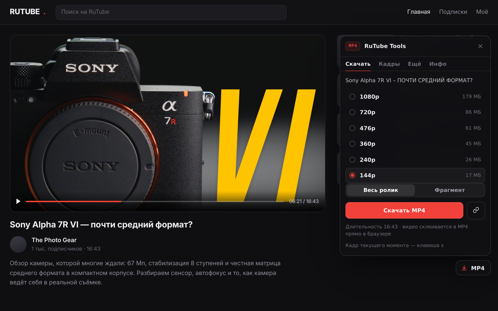
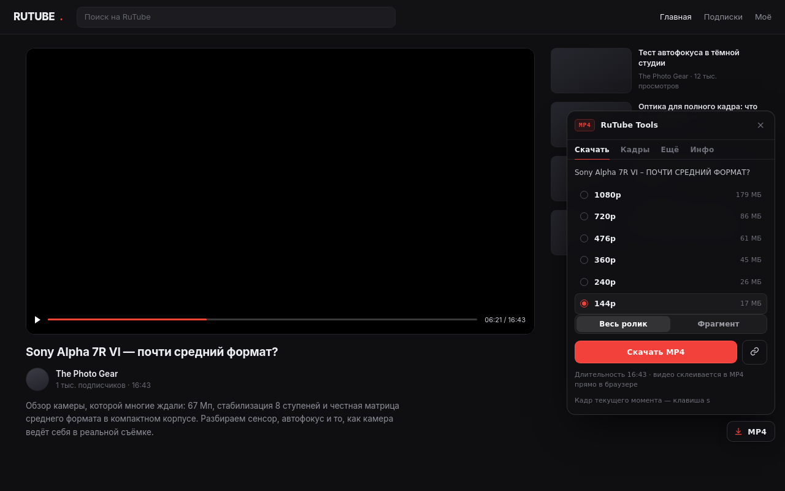
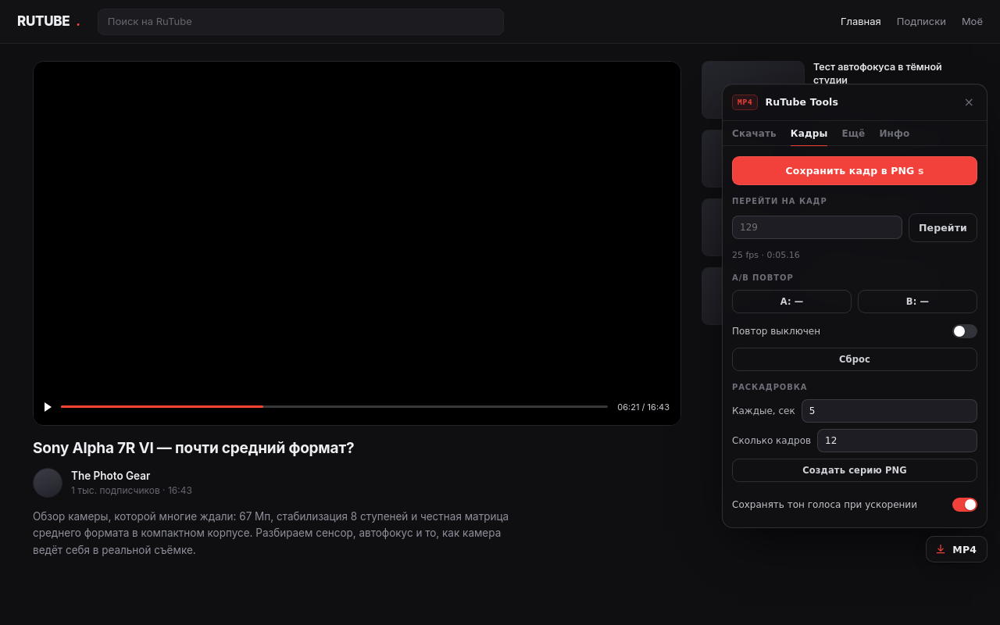
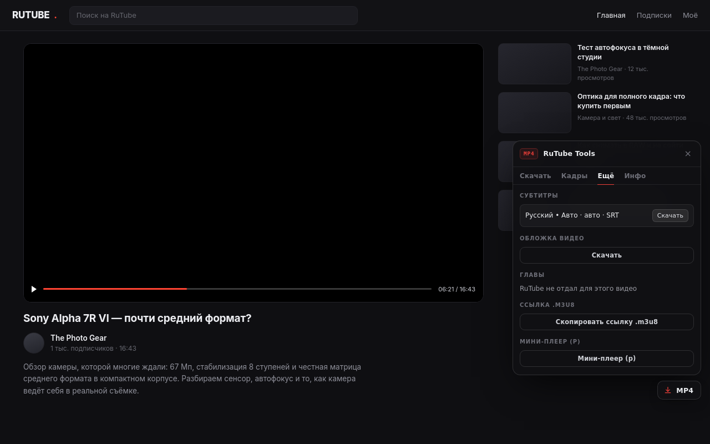
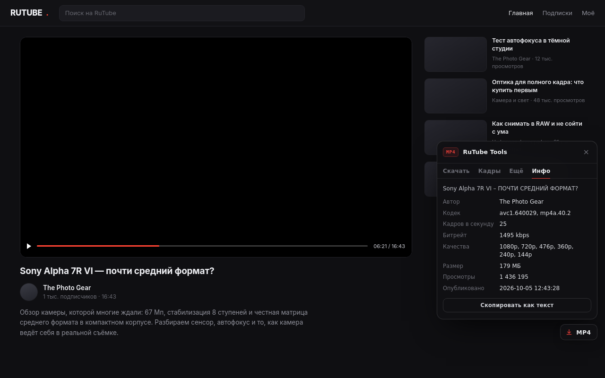
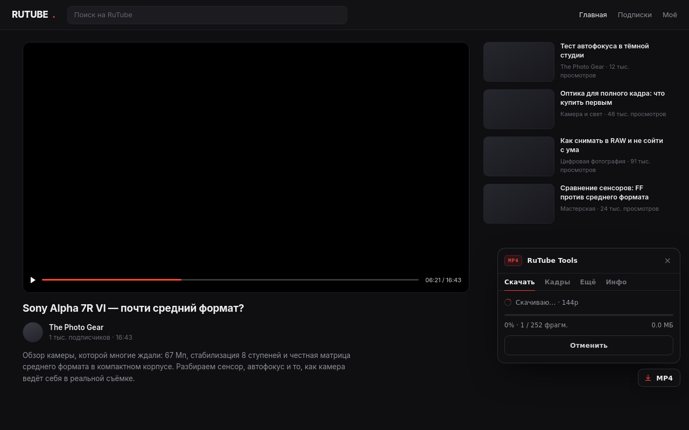
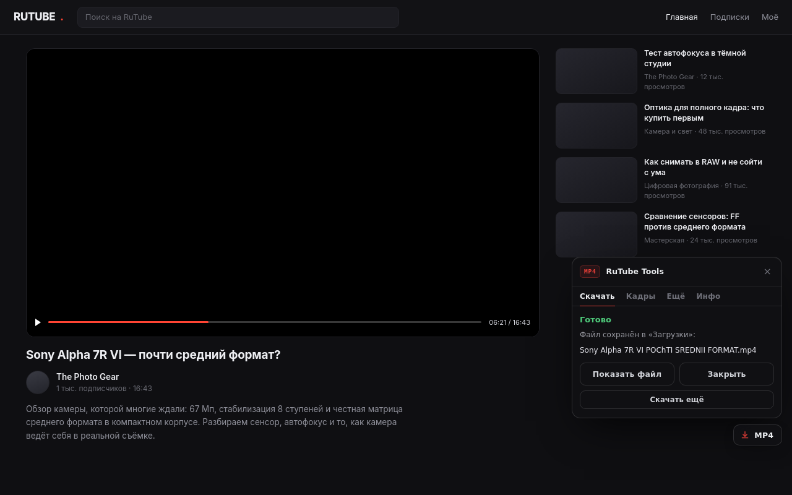

<div align="center">



<h1>RuTube Tools</h1>

<p><b>Покадровая перемотка, кадры в PNG и скачивание в MP4 — прямо в плеере RuTube</b></p>

<a href="https://github.com/xxnetme/rutube-tools/releases/latest"></a>
<a href="https://github.com/xxnetme/rutube-tools/actions/workflows/checks.yml"></a>


<a href="LICENSE"></a>

<p>
<a href="https://xxnetme.github.io/rutube-tools/">Сайт</a> &nbsp;·&nbsp;
<a href="#установка">Установка</a> &nbsp;·&nbsp;
<a href="#возможности">Возможности</a> &nbsp;·&nbsp;
<a href="#клавиши">Клавиши</a> &nbsp;·&nbsp;
<a href="#как-это-работает">Как это работает</a> &nbsp;·&nbsp;
<a href="#ограничения">Ограничения</a>
</p>

</div>

---

## Что это

Расширение добавляет в RuTube то, чего в нём нет: покадровую перемотку как в видеоредакторе,
сохранение кадра в PNG и скачивание в MP4 — целиком, фрагментом по таймкодам или целым плейлистом.
Всё считается в браузере: без сторонних программ, без ffmpeg, без рекламы и сбора данных.



---

## Интерфейс



<table>
<tr>
<td width="50%"><br>
<sub><b>Скачать</b> — качества, оценка размера, весь ролик или фрагмент</sub></td>
<td width="50%"><br>
<sub><b>Кадры</b> — шаг по кадрам, переход по номеру, петля A/B, раскадровка</sub></td>
</tr>
<tr>
<td><br>
<sub><b>Ещё</b> — субтитры, обложка, главы, ссылка .m3u8, мини-плеер</sub></td>
<td><br>
<sub><b>Инфо</b> — кодек, fps, битрейт, качества, просмотры, дата</sub></td>
</tr>
<tr>
<td><br>
<sub><b>Прогресс</b> — фрагменты, мегабайты, скорость, текущий сервер</sub></td>
<td><br>
<sub><b>Готово</b> — файл в загрузках, «показать файл», «скачать ещё»</sub></td>
</tr>
</table>

---

## Возможности

### Скачивание

| | |
|---|---|
| **MP4 целиком** | 1080p…144p. Фрагменты потока качаются параллельно и собираются в обычный MP4 в браузере |
| **Фрагмент** | «с 12:30 по 12:45». Кнопка со временем берёт позицию прямо из плеера; фактические границы видны до старта |
| **Плейлист** | На странице `/plst/…`: очередь с паузой, диапазон серий, отчёт об ошибках по каждому видео |
| **Зеркала CDN** | Каждое качество RuTube отдаёт с двух серверов — при обрыве расширение перечитывает плейлист с резервного |
| **Длинные файлы** | Автоматическое разбиение по ~220 МБ: `название — 1/3.mp4` |
| **После сбоя** | «Повторить загрузку» и «Скопировать диагностику» — готовый текст для письма в поддержку |

### Кадры

Шаг вперёд и назад по кадрам с показом номера и таймкода, сохранение кадра в PNG,
переход на кадр по номеру, петля A/B и раскадровка серией PNG через заданный интервал (до 120 кадров).
Тон голоса при ускорении сохраняется.

### Ещё и Инфо

Субтитры SRT, включая авто-субтитры, обложка в JPG, главы из `cuepoints`, мини-плеер (Picture-in-Picture)
и ссылка `.m3u8`. Вкладка «Инфо» показывает кодек, fps, битрейт, доступные качества, оценку размера,
просмотры, дату публикации и автора — с копированием одним нажатием.

---

## Установка

**Firefox** — [скачать rutube-tools-firefox.xpi](https://github.com/xxnetme/rutube-tools/releases/latest/download/rutube-tools-firefox.xpi),
затем `about:debugging#/runtime/this-firefox` → «Загрузить временное дополнение».

**Chrome, Edge, Яндекс.Браузер** — [скачать rutube-tools-chromium.zip](https://github.com/xxnetme/rutube-tools/releases/latest/download/rutube-tools-chromium.zip),
распаковать, затем `chrome://extensions` → «Режим разработчика» → «Загрузить распакованное».

<details>
<summary>Сборка из исходников</summary>

```bash
git clone https://github.com/xxnetme/rutube-tools.git
cd rutube-tools
python3 build.py
```

Нужен только Python 3: сборка проверяет обязательные файлы, манифест и отсутствие `eval`,
затем складывает распакованные версии в `build/`, а архивы и `.xpi` — в `release/`.

</details>

---

## Клавиши

| Клавиша | Действие |
|---|---|
| <kbd>,</kbd> <kbd>.</kbd> | кадр назад / кадр вперёд |
| <kbd>&lt;</kbd> <kbd>&gt;</kbd> | скорость − / + (0.25× … 2×) |
| <kbd>s</kbd> | сохранить кадр в PNG |
| <kbd>p</kbd> | мини-плеер |
| <kbd>?</kbd> | подсказка на странице |

Полный набор «как на YouTube» включается в настройках: <kbd>Space</kbd>/<kbd>K</kbd> — пауза,
<kbd>J</kbd>/<kbd>L</kbd> — ±10 с, стрелки — перемотка и громкость, <kbd>M</kbd> — звук,
<kbd>0</kbd>–<kbd>9</kbd> — переход по проценту. Клавиши кадров и кадра PNG переназначаются.

---

## Как это работает

```text
URL видео
   |
   +-- rutube.ru/api/play/options/<id>/     качества, длительность, субтитры, обложка
   |        +-- master.m3u8                 каждое качество x 2 зеркала CDN
   |                 +-- media.m3u8         фрагменты по 2-4 секунды
   |
   +-- параллельная загрузка (5 потоков, повторы, смена зеркала)
   |
   +-- mux.js: MPEG-TS -> fMP4  ->  Blob  ->  downloads.download()
                                           |
                                      Firefox: фоновая страница
                                      Chromium: offscreen-документ
```

Файл скачивается без перекодирования. Фрагменты попадают в сборщик строго по порядку даже при
параллельной загрузке, поэтому MP4 получается валидным — проверено `ffprobe`.

---

## Ограничения

| Что | Поведение |
|---|---|
| Прямые эфиры | не скачиваются, кнопка сообщает об этом |
| DRM-видео | не скачиваются |
| HEVC и AV1 | сохраняются как `.ts`, открывается в VLC |
| Гео-блокировка RuTube | не обходится |
| Только звук (M4A) | в планах: mux.js всегда собирает обе дорожки |
| Скорость | ограничена отдачей CDN RuTube |
| Кадр в PNG | если браузер запрещает чтение видеопотока, кадр сохранить нельзя — расширение скажет об этом |

---

## Приватность

Ноль аналитики, телеметрии и рекламы. Расширение работает только на `rutube.ru`, запросы идут
исключительно к RuTube и его CDN, без cookie. Настройки и позиция просмотра хранятся локально
в `storage.local`. В манифесте указано `data_collection_permissions: none`.
Подробнее — [docs/PRIVACY.md](docs/PRIVACY.md).

---

## Структура

```text
rutube-tools/
├── src/
│   ├── manifest.firefox.json    MV3, background.scripts
│   ├── manifest.chromium.json   MV3, service_worker + offscreen
│   ├── background.js            загрузки, очередь, обрезка, зеркала, диагностика
│   ├── content-core.js          кнопка, панель, вкладки, клавиши, кадры, PiP
│   ├── content-panel.js         Скачать / Кадры / Ещё / Инфо
│   ├── lib/engine.js            HLS, диапазоны, плейлисты, склейка
│   ├── lib/i18n.js              русский и английский
│   ├── lib/mux-mp4.min.js       mux.js, Apache 2.0
│   ├── popup.html, popup.js     настройки
│   └── offscreen.html, .js      сборка MP4 для Chromium
├── build.py                     сборка и проверки, только stdlib
├── docs/                        CHANGELOG, FEATURES, PRIVACY, PUBLISH, скриншоты, лендинг
├── assets/                      баннеры и обложка, исходники в SVG
└── .github/workflows/           checks и release по тегу
```

---

## Проверено на живом RuTube

- Полное видео 16:43 → MP4 20,9 МБ, `ffmpeg` декодирует без ошибок
- Фрагмент 1:40–2:10 → файл длиной 32,15 с, старт со 100-й секунды
- Плейлист из двух видео → два валидных файла, 45,4 и 42,2 МБ
- Субтитры SRT (41 КБ) и обложка JPG (268 КБ) сохранены из Firefox
- PNG-кадры и раскадровка, петля A/B не выходит за границы
- Переключение RU/EN на лету, консоль без ошибок

---

## Автор

<table>
<tr>
<td width="56"></td>
<td>

**xxnetme** — разработчик и автор проекта<br>
<sub><a href="https://github.com/xxnetme">github.com/xxnetme</a> · <a href="https://github.com/xxnetme/rutube-tools/issues">сообщить о проблеме</a> · <a href="https://github.com/xxnetme/rutube-tools/blob/main/SECURITY.md">безопасность</a></sub>

</td>
</tr>
</table>

Проект распространяется по лицензии [MIT](LICENSE). Сторонние компоненты перечислены в
[THIRD-PARTY-NOTICES.md](THIRD-PARTY-NOTICES.md).

<sub>Расширение не обходит DRM и не скачивает закрытые видео. Скачивайте только то, на что у вас есть право.</sub>
